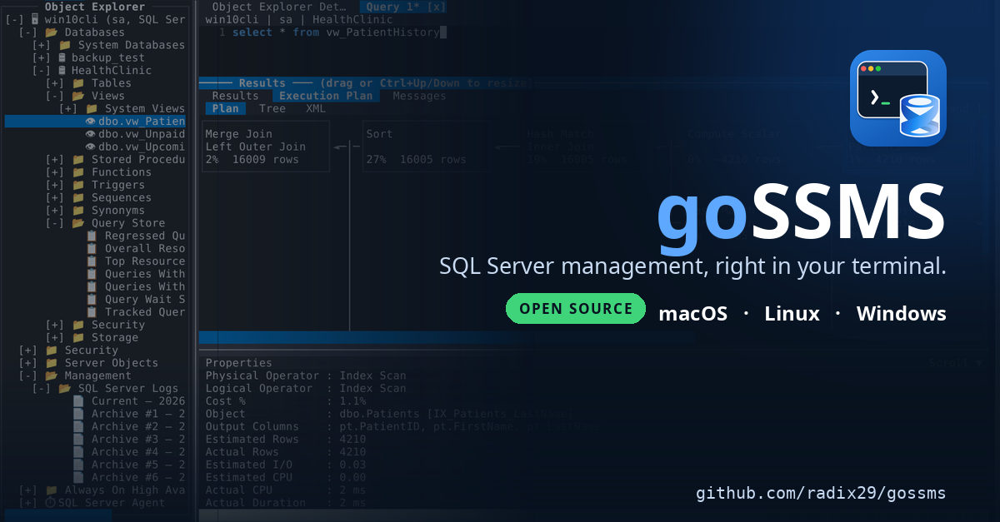
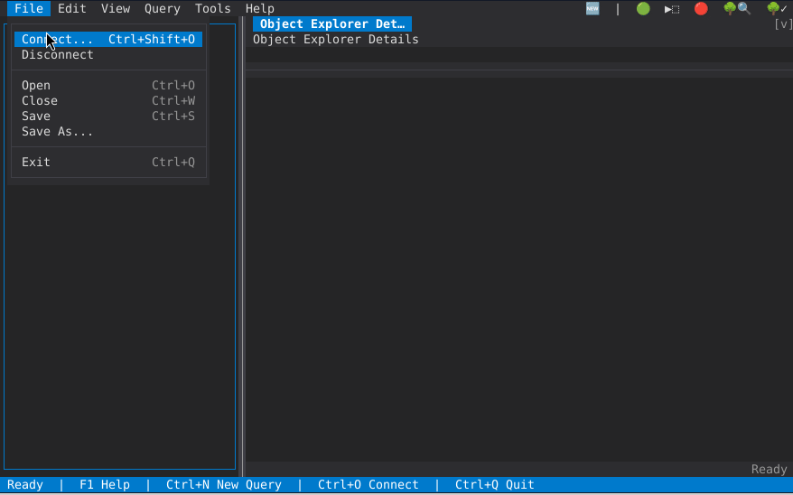

<p align="center">
  <br/>
  <strong>SQL Server management for Linux, macOS, and Windows</strong>
</p>

# goSSMS
[](https://github.com/radix29/gossms/commits/main)
[](LICENSE)
[](https://github.com/radix29/gossms/actions/workflows/release.yml)
[](https://pkg.go.dev/github.com/radix29/gossms)
[](go.mod)
[](https://github.com/radix29/gossms/releases)
[](https://discord.gg/7YVKzB3vZ)


goSSMS is a terminal-based SQL Server management application. It is distributed
as a single executable and does not require an installer, SQL client tools, or
separate database drivers.



## Installation

### 1. Install goSSMS

#### Homebrew — macOS and Linux

```bash
brew install radix29/tap/gossms
```

Apple silicon and Intel; `brew upgrade gossms` tracks new releases.

#### APT — Debian, Ubuntu and derivatives

```bash
sudo install -d -m 0755 /etc/apt/keyrings
curl -fsSL https://radix29.github.io/apt/gossms.asc \
  | sudo tee /etc/apt/keyrings/gossms.asc > /dev/null
echo "deb [signed-by=/etc/apt/keyrings/gossms.asc] https://radix29.github.io/apt stable main" \
  | sudo tee /etc/apt/sources.list.d/gossms.list > /dev/null
sudo apt-get update && sudo apt-get install gossms
```

`amd64` and `arm64`. Details at
[radix29.github.io/apt](https://radix29.github.io/apt).

#### Direct download

Download the latest release for your platform:

**https://github.com/radix29/gossms/releases/latest**

Release binaries are available for:

- Windows (amd64 and arm64)
- Linux (amd64 and arm64)
- macOS (Apple silicon/arm64 and Intel/amd64)

Extract the downloaded archive before running the application.

The binaries themselves are not signed for Windows SmartScreen or macOS
Gatekeeper, so those will warn on first run. Integrity is covered instead by
`checksums.txt`, published with every release and signed by the release
workflow with [cosign](https://github.com/sigstore/cosign) in keyless mode:

```bash
sha256sum -c --ignore-missing checksums.txt
cosign verify-blob \
  --bundle checksums.txt.bundle \
  --certificate-oidc-issuer https://token.actions.githubusercontent.com \
  --certificate-identity-regexp '^https://github\.com/radix29/gossms/\.github/workflows/release\.yml@' \
  checksums.txt
```

Packages installed through Homebrew or APT are covered without any of this:
Homebrew checks the formula's `sha256`, and APT checks the repository's
GPG-signed `Release` file.

### 2. Start goSSMS

Installed through Homebrew or APT, `gossms` is already on your `PATH`:

```bash
gossms
```

On Linux, both also add a **goSSMS** entry to the desktop's application menu,
which opens it in a terminal.

Otherwise, on Windows, open PowerShell in the extracted folder and run:

```powershell
.\gossms.exe
```

On Linux or macOS, open a terminal in the extracted folder and run:

```bash
chmod +x ./gossms
./gossms
```

`gossms --version` prints the version, commit, build date and licence and exits,
without starting the interface — quote it when reporting a bug.

You need a modern terminal with UTF-8 and 256-colour support, plus network access
to a SQL Server instance.

### 3. Connect to SQL Server

The Connect to Server dialog opens at startup. **History** (left) lists saved
connections, most recent first; select one and press Enter to connect. Below
about 96 columns History is hidden and the form fills the dialog.

The form has two tabs, **Connection Properties** and **Connection String**
(Ctrl+PgUp/PgDn). **Reset** restores defaults; **Delete** removes the selected
history entry and its saved password. Tab reaches the buttons after the last
field; Left/Right move along them.

Choose SQL Server, Windows Integrated, or a Microsoft Entra ID method. Fields the
method does not use are greyed out.

- **Server Name**: `host`, `host,1500`, `host:1500` or `host\instance`. Give no
  port for a named instance, so SQL Browser resolves it. IPv6: `fe80::1` or
  `[fe80::1]:1433`.
- **Remember Password**: off by default; the password is saved to `config.json`
  only when ticked.
- **Encryption**: Mandatory with **Trust Server Certificate** off by default,
  so the server must present a trusted certificate matching its hostname.
  Enable it only for trusted development environments: it disables server
  certificate validation. Existing saved connections keep their setting.
  **Strict** (TDS 8.0) needs SQL Server
  2022+ or Azure SQL Managed Instance.
  On Windows and macOS, setting `SSL_CERT_FILE` or `SSL_CERT_DIR` (Python and
  some corporate images do) makes validation, including Entra sign-in, use
  those files instead of the system certificate store, so a CA trusted only
  there fails with `certificate signed by unknown authority`. Unset the
  variable, or start goSSMS with `GODEBUG=x509sslcertoverrideplatform=0`.
- **Custom Properties**: extra driver settings as `key=value` pairs separated by
  `;` or `&`, e.g. `ApplicationIntent=ReadOnly`. SSMS's spellings work too
  (`Application Intent=ReadOnly`, `Multi Subnet Failover=True`); giving both
  spellings of one setting is refused.

| Entra method | Fields |
|---|---|
| **MFA** | Browser sign-in; **User** is an optional hint. |
| **Device Code** | Code entered on any device; for SSH or no browser. |
| **Password** | **User** and **Password**. No MFA; deprecated. |
| **Service Principal** | **Client ID** and secret in **Password**. |
| **Managed Identity** | **Client ID** for user-assigned; blank for system-assigned. |
| **Default** | Environment, managed identity, then Azure CLI. |
| **Azure CLI** | The account `az login` signed in. |

Sessions appear on the server as `goSSMS`, `goSSMS - Query` and
`goSSMS - Activity Monitor`.

Connections whose hostname ends in `datawarehouse.fabric.microsoft.com` use
a Fabric Data Warehouse tree layout: only **Databases** and **Security** at the
server root. Server **Security** contains only **Logins** and **Server Roles**.
**Tables** lists user tables without System Tables, FileTables, External Tables,
or Graph Tables folders; individual tables omit Triggers and Indexes.
**External Data Sources** appears directly under each database instead of
**External Resources**, without External File Formats or External Libraries.
**Programmability** contains only Stored Procedures, Functions, and External
Functions. **External Functions** lists `sys.objects` entries of type `XF`.
Databases omit Query Store, Service Broker, and Storage; database **Security**
contains only Users, Roles, and Schemas. This layout is per connection; other
connected servers keep their usual folders.

Fabric statistics lists use `sys.stats` and `STATS_DATE`, without the unsupported
`sys.dm_db_stats_properties` DMV. Selecting a statistic shows its
`DBCC SHOW_STATISTICS ... WITH STAT_HEADER` results in Object Explorer Details,
without opening a query tab.
Unavailable DMV counters in General properties appear as `n/a`; DBCC-backed
Details, Histogram, and Density Vector pages remain available.

Always On peer discovery uses each replica's registered connection: one you
have connected to through **File > Connect** or the prompt below. A unique
short-name alias still uses the original saved address; ambiguous aliases are
refused. Where a dialog or action needs a replica with no saved connection
(Add Replica, New Availability Group, New Endpoint, the availability group and
listener Properties pages, Add Database, Add Listener, failover and the other
group actions, a group's Dashboard, or **Enter** on Object Explorer's "(partial — Enter to connect
to …)" note), goSSMS opens the Connect dialog for it, pre-filled from the connection
you started from; nothing is sent to that instance until you press Connect. A
failed peer connection never retries with another server's credentials.

## Supported SQL Server versions

goSSMS supports **SQL Server 2016 SP1 (13.0.4001) and later** on Windows and
Linux, and **Azure SQL Managed Instance**. Features that are unavailable on the
connected SQL Server version or engine edition are hidden or disabled. An
older instance still connects, with a warning that some folders and dialogs
will fail.

## Required rights

goSSMS adds no privileges: each action needs the same permission it would in
other clients. Connecting needs `CONNECT SQL`; listing databases may need
`VIEW ANY DATABASE`. Live data such as Activity Monitor and Live Query
Statistics needs `VIEW SERVER STATE` (on SQL Server 2022+, `VIEW SERVER
PERFORMANCE STATE` or `VIEW SERVER SECURITY STATE`); without it a query still
runs and returns its actual plan, but shows no live view.

Where a permission is missing, the action is disabled, the page opens read-only,
or values show as `N/A`.

## Configuration

Settings and the 30 most recent connections are saved automatically in:

- Linux/macOS: `~/.config/gossms/config.json`
- Windows: `%APPDATA%\gossms\config.json`

Tools > Options sets icon style, color theme (Dark, the default, or Light),
grid and text column widths, indent size, Max fetch rows (rows kept per result
set in grid, text and file mode, 0 = unlimited; reaching it cancels the rest
of the script, later GO batches included, and the results status line says so) and
IntelliSense. Unsaved query tabs are recovered to the `recovered` folder beside
`config.json` after a crash.

Saved passwords are encrypted with AES-256-GCM using `gossms.key` in the same
folder; delete both files to reset. Editing a connection's server, port, user,
authentication or encryption settings by hand invalidates its saved password.

## Links

- [Releases and downloads](https://github.com/radix29/gossms/releases)
- [Release notes](https://github.com/radix29/gossms/blob/main/RELEASE.md)
- [Report an issue](https://github.com/radix29/gossms/issues)
- [Discord server](https://discord.gg/7YVKzB3vZ) — questions, feedback and release announcements

## License

goSSMS is © 2026 radix29 and licensed under
[GPL-3.0-or-later](LICENSE). The bundled
[sp_WhoIsActive](https://github.com/amachanic/sp_whoisactive) is © 2007–2026
Adam Machanic and retains its own GPL-3.0 copyright.
