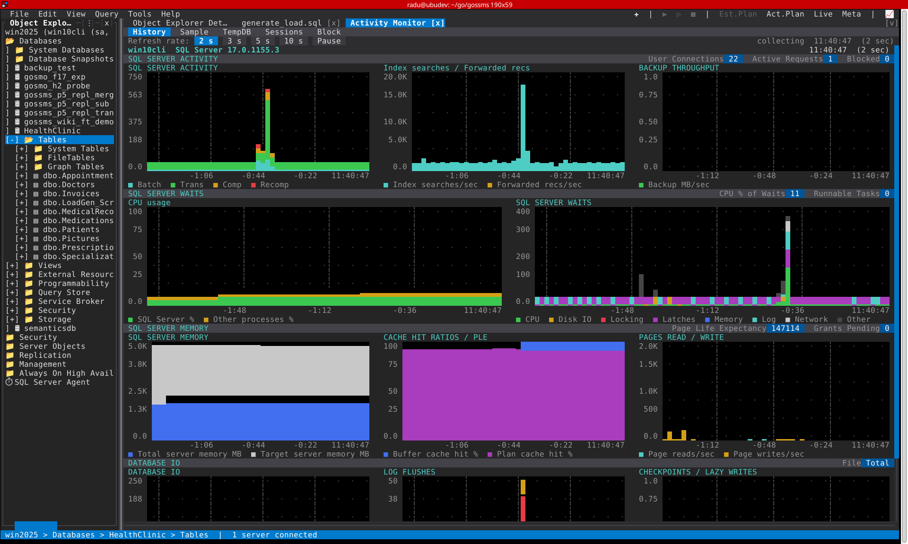
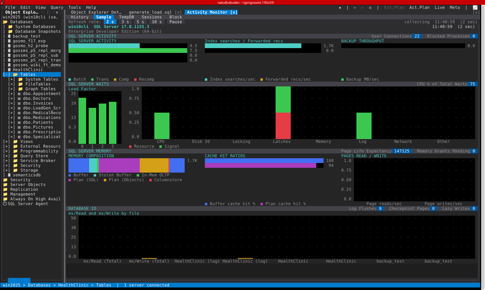
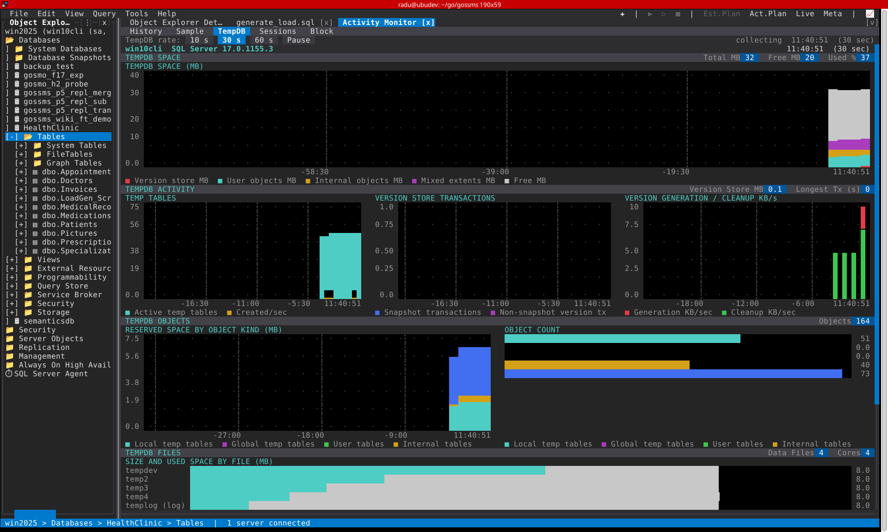
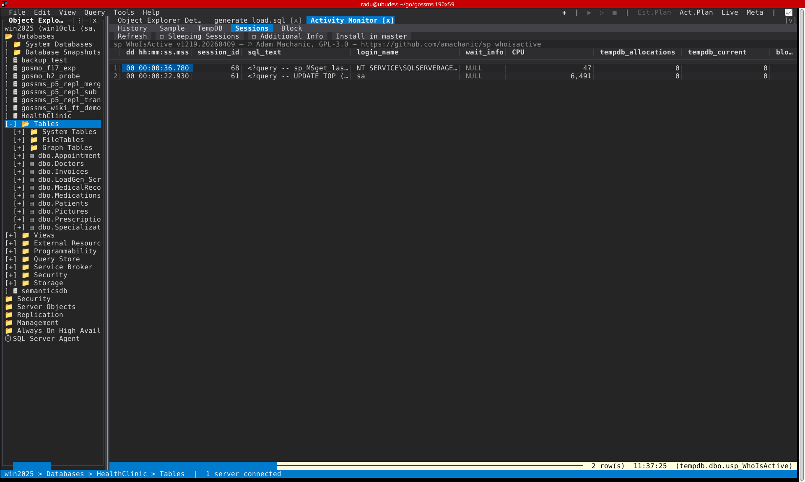

# Activity Monitor in Your Terminal: Live SQL Server Diagnostics with goSSMS

When a SQL Server instance slows down, the first question is always the same: *what is it doing right now?* For most of us the answer lives in SQL Server Management Studio's Activity Monitor, which means a Windows machine, a GUI session, and often a remote desktop hop to get there.

goSSMS is an open-source, terminal-based reimplementation of SSMS, written in Go. It runs on Linux, macOS and Windows as a single binary with no CGO and no installer. Its Activity Monitor (Tools menu) brings live instance diagnostics to any terminal, including an SSH session into a jump box.

Below is a tour of its four main views, captured against a SQL Server 2025 instance under a synthetic mixed workload (CPU bursts, inserts and updates, sorts spilling to tempdb).

## History: the last few minutes at a glance



The **History** tab plots rolling charts, sampled every 2, 3, 5 or 10 seconds, with pause and resume:

- **SQL Server activity**: batch requests, transactions, compilations and recompilations, plus index searches and forwarded records per second.
- **Waits**: CPU usage (SQL Server versus other processes) and wait time grouped by class: CPU, disk I/O, locking, latches, memory, log, network.
- **Memory**: total versus target server memory, buffer and plan cache hit ratios, page life expectancy, pages read and written per second.
- **Database I/O**: file I/O, log flushes, checkpoints and lazy writes.

The header badges (user connections, active requests, blocked processes, CPU share of waits, runnable tasks, pending memory grants) give the instance's vital signs in one line.

The value of history over a snapshot shows in the capture: the load script's burst is visible as a spike across batches, waits, page writes and log flushes, and you can see the instance settle back afterwards. A counter that only shows "now" cannot tell you whether a problem is starting or ending.

## Sample: the instantaneous view



**Sample** shows the same families of counters as bars rather than time series. It adds two views that are hard to get elsewhere in a quick glance: the wait *load factor* across schedulers, and the memory composition (buffer pool, stolen buffers, in-memory OLTP, plan cache, columnstore). The per-file latency chart shows ms/read and ms/write for every database file, which is usually the fastest way to tell whether a slow query is a storage problem.

## TempDB: space, version store, and who is using it



tempdb trouble is one of the most common causes of "the server is slow" tickets, and also one of the least visible. This tab tracks:

- Space by consumer: user objects, internal objects (sorts, hashes, spills), version store, mixed extents and free space.
- Active temp tables and creation rate, version store size, version generation versus cleanup, and the longest-running transaction holding the version store open.
- Reserved space by object kind, and size and used space for each tempdb file, which makes uneven file sizing obvious.

With the sort-heavy load running, internal object growth is plainly visible, and the per-file view confirms all four data files fill evenly.

## Sessions: who is running what



The **Sessions** tab runs Adam Machanic's [sp_WhoIsActive](https://github.com/amachanic/sp_whoisactive), the de facto standard for this question, and presents its result as a sortable grid: elapsed time, session id, SQL text, login, wait info, CPU, reads and writes, tempdb allocations, blocking session and more. If it is not installed, goSSMS offers to install it into `master` (the **Install in master** button).

Toggles for sleeping sessions and additional info, a **Block** tab for blocking chains, and a right-click menu to open a **live execution plan** or kill a session complete the loop from "something is slow" to "this statement, from this login, is the cause".

## Why a terminal tool

- **Remote-friendly.** It works over SSH, in tmux, on a headless box or a locked-down jump host, with no GUI forwarding.
- **Cross-platform.** One build for Linux, macOS and Windows.
- **Light on the server.** It uses its own connection (visible on the server as `goSSMS - Activity Monitor`) and reads standard DMVs; permissions are checked and gated like the rest of the tool.
- **Keyboard first.** `Tab` cycles the views, `P` pauses collection, `+`/`-` change the refresh rate, `R` reruns the session query; the mouse works too.

## Try it

### Install goSSMS

#### Homebrew — macOS and Linux

```bash
brew install radix29/tap/gossms
```

Apple silicon and Intel; `brew upgrade gossms` tracks new releases.

#### APT — Debian, Ubuntu and derivatives

```bash
sudo install -d -m 0755 /etc/apt/keyrings
curl -fsSL https://radix29.github.io/apt/gossms.asc \
  | sudo tee /etc/apt/keyrings/gossms.asc > /dev/null
echo "deb [signed-by=/etc/apt/keyrings/gossms.asc] https://radix29.github.io/apt stable main" \
  | sudo tee /etc/apt/sources.list.d/gossms.list > /dev/null
sudo apt-get update && sudo apt-get install gossms
```

`amd64` and `arm64`. Details at [radix29.github.io/apt](https://radix29.github.io/apt).

#### Direct download

Download the latest release for your platform: <https://github.com/radix29/gossms/releases/latest>

Release binaries are available for:

- Windows (amd64 and arm64)
- Linux (amd64 and arm64)
- macOS (Apple silicon/arm64 and Intel/amd64)

Extract the downloaded archive before running the application.

The binaries themselves are not signed for Windows SmartScreen or macOS Gatekeeper, so those will warn on first run. Integrity is covered instead by `checksums.txt`, published with every release and signed with [cosign](https://github.com/sigstore/cosign) in keyless mode:

```bash
sha256sum -c --ignore-missing checksums.txt
cosign verify-blob \
  --bundle checksums.txt.bundle \
  --certificate-oidc-issuer https://token.actions.githubusercontent.com \
  --certificate-identity-regexp '^https://github\.com/radix29/gossms/\.github/workflows/release\.yml@' \
  checksums.txt
```

Homebrew and APT installs are covered without this: Homebrew checks the formula's `sha256`, and APT checks the repository's GPG-signed `Release` file.

Source and releases: <https://github.com/radix29/gossms>

Connect to an instance, open **Tools > Activity Monitor**, and press `Tab`. Feedback and issues are welcome on the repository.

*#SQLServer #DBA #Go #OpenSource #PerformanceTuning #TUI*
